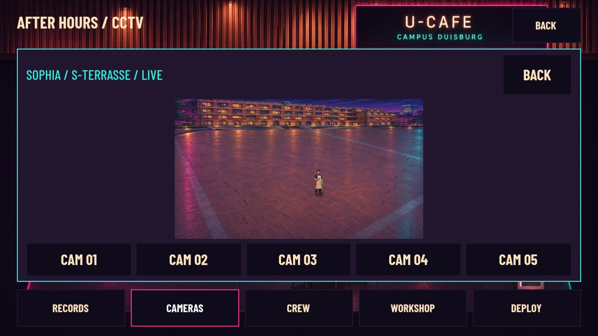

# Shinkoiwa Sardistic — Support

 

[App Store](https://apps.apple.com/app/id6835122148) | [Max on Reddit](https://www.reddit.com/user/dot-app/) | [Contact](#contact)

An offline neon-noir action and surveillance game by Nick, Baris & Max.

[App Store](https://apps.apple.com/app/id6835122148) · [Deutsch](SUPPORT.de.md) · [日本語](SUPPORT.ja.md)

## Get help

[Open a support request](https://github.com/Somamill/shinkoiwa-support/issues/new). Include the game version, device model, operating system, and steps to reproduce the issue. Please do not post passwords, private recordings, personal contact information, or other sensitive material in public issues.

## Playing

Choose ENTER THE NIGHT, follow the voiced introduction, select a character, and enter the night. On iPhone and iPad, move with the left joystick and use the action icons. On Mac, use WASD to move, the mouse to aim/fire, right click for melee, R to reload, Space for the character ability, E to interact, and Escape to pause. Leon's ability charges while held and releases when let go. Cleared-room doors open automatically; select Continue after clearing a night.

Research, character unlocks, and settings save locally. An active night run is session-only. There is no account, multiplayer service, advertising, subscription, or real-money purchase. Randomized rewards use only research earned by playing.

## Saves and updates

When your build offers **Settings → Game Center / iCloud**, sign in to Game Center and enable iCloud Drive to use optional cloud saves. Keep the game open until the sync status finishes. If the game asks which save to use, check the night and collection counts first. Keep your current installation until you confirm the progress you want is available. Include the sync status in a support report and keep account details private.

App Store and TestFlight versions can differ. Check the version on the game’s main menu when reporting an issue.

CCTV preview from the 0.6.12 test build. Features depend on the build you install.

## Privacy and notices

[Privacy Policy](PRIVACY.md) · [Third-party notices](THIRD_PARTY.md)

This support repository contains public documentation only. The game source repository remains private.

## Contact

Questions, ideas, or spotted a bug? [Email Max](mailto:max@miller-max.com). Feedback is always welcome.

[Support Max on Ko-fi](https://ko-fi.com/somamill)
